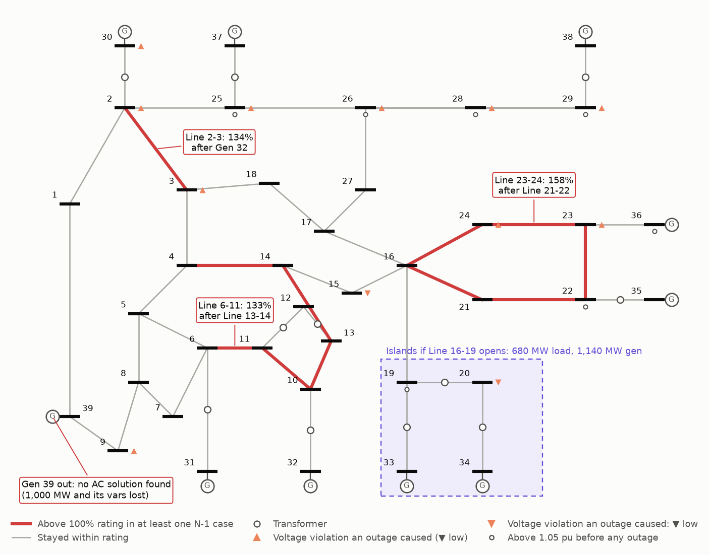
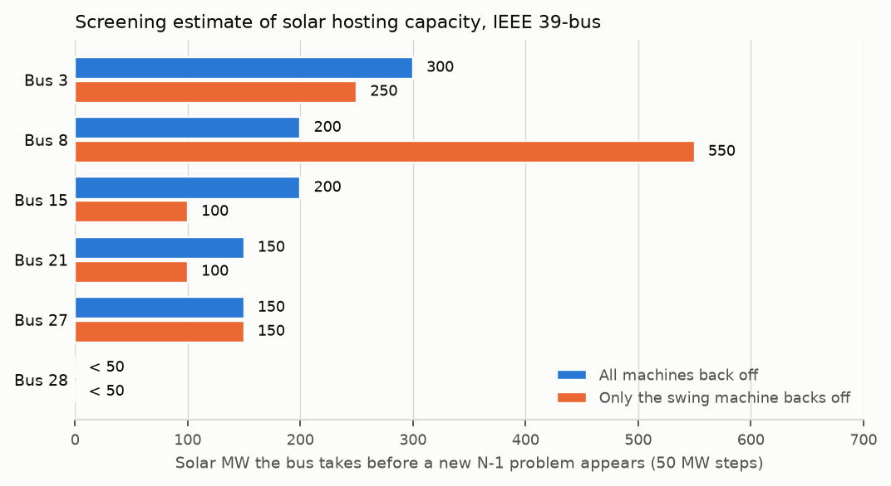

# N-1 contingency screening in Python, IEEE 39-bus

A scripted steady-state planning study on a public test system: a base-case AC load flow, every single outage (N-1) checked for thermal overloads and voltage violations, and a screening estimate of how much solar six buses could take before an N-1 problem appears.

I built this as a student learning the layer under the dispatch work I've done before. My microgrid project only decided how much solar, battery and diesel to use. It had no network model, so it couldn't say whether the grid could carry the result. This repo is my first pass at that question. **Claude Code wrote most of the code** (see [AI use](#ai-use)), and the study is a textbook exercise, not a real-system result.

**Worst ten single outages** (primary scenario: generator Q limits on, lost MW shared across machines by headroom).

- **Ranking rule:** outages with no solution first, then by load lost, then by worst overload, then by voltage excursion.
- **What counts:** only problems the outage causes. Problems already present before it are excluded.

<!-- n1_table -->
| Rank | Outage | Result | Worst problem the outage causes |
|---:|---|---|---|
| 1 | Gen 39 | No AC solution found (1,000 MW lost). Model boundary: bus 39 is the external-system equivalent | not assessed (no solution) |
| 2 | Line 16-19 | Islands bus 19, 20, 33, 34: 680 MW load lost | Line 2-3 at 109% |
| 3 | Xfmr 19-20 | Islands bus 20, 34: 680 MW load lost | none |
| 4 | Xfmr 6-31 | Islands bus 31: 9 MW load lost | Line 2-3 at 133% (+1 more) |
| 5 | Line 21-22 | Solved | Line 23-24 at 158% (+2 more) |
| 6 | Gen 32 | Solved | Line 2-3 at 134%; Bus 32 low at 0.924 pu |
| 7 | Xfmr 10-32 | Islands bus 32: no load lost | Line 2-3 at 134% |
| 8 | Gen 31 | Solved | Line 2-3 at 134% (+1 more); Bus 31 low at 0.914 pu |
| 9 | Line 13-14 | Solved | Line 6-11 at 133% (+1 more) |
| 10 | Xfmr 22-35 | Islands bus 35: no load lost | Line 2-3 at 130% |
<!-- /n1_table -->



## What the study found

- **22 of 56 outages are clean.** 24 cause an overload, 13 cause a new or worsened voltage violation, and 3 lose load. The categories overlap. Two of the 13 voltage cases are only at the terminal bus of the unit that tripped.
- **The worst overload is Line 23-24 at 157.7% with Line 21-22 out.** Buses 22 and 23 hold Gen 35 and Gen 36. With Line 21-22 out, Line 23-24 is their only path to the rest of the system. A back-of-envelope estimate from the pocket's generation minus load (962.5 MW into a 600 MVA line) gives 160.4%.
- **A second problem area doesn't depend on any dispatch assumption.** The corridor that carries Gen 31 and Gen 32 output (Lines 4-14, 6-11, 10-11, 10-13 and 13-14) overloads when any of those five lines is out, in both dispatch models. The worst is Line 6-11 at 132.5% with Line 13-14 out.
- **Losing Gen 39 has no AC solution, but this is a model-boundary result, not a credible contingency.** Bus 39 is the case's equivalent for the rest of the interconnection, and MATPOWER set its Pmax and Q limits by rule. Stepping the unit down slowly suggests why it fails. The case still solves at 0 MW while the unit supplies 230 Mvar, with bus 39 at 0.835 pu. At that point the other machines are 61.7 MW short of real power, and the worst branch is at 147.7%. It fails at 220 Mvar. A failed Newton solve is not proof of voltage collapse.
- **Line 16-19 is the only tie to buses 19, 20, 33 and 34.** Losing it separates a pocket with 1,140 MW of generation and 680 MW of load. This study does not solve islands and counts the pocket as de-energised. That is pessimistic for the load, and says nothing about whether the island would hold. Xfmr 19-20 really is radial supply to bus 20's 680 MW.
- **How lost generation is replaced changes which line overloads.**
  - Line 2-3 is the worst element in 7 of the 9 solved machine outages. That's mainly because 790 of the 1,101 MW of headroom sits on Gen 30, next to Line 2-3.
  - If the swing machine picks up everything instead, 14 outages overload rather than 24. But bus 31 then runs far past its 646 MW limit, for example 1,524 MW after losing Gen 38.
  - Neither model is how a real system responds, so both are reported.
- **Solar hosting is small once existing problems count.** Under the same rule the N-1 study uses, 8 of the 12 bus and dispatch cases take less than 50 MW. Those buses push overloads the case already has further. Counting only new problems gives up to 300 MW, and the answer moves with the dispatch assumption: at bus 8 it is 200 MW if every machine backs off for the solar, or 550 MW if only the swing machine does.



## Check the data first

Before trusting any study, I checked the inputs. Both findings are in [`results/data_check.json`](results/data_check.json).

- **Thermal ratings.** `pandapower.networks.case14()` has placeholder ratings: lines at 42 to 27,480 kA and transformers at 9,900 MVA. Base-case loading peaks at 1.51%, so a thermal check on that case means nothing.
  - `case39` has non-placeholder ratings: lines 480 to 1,200 MVA and transformers 500 to 1,800 MVA. MATPOWER credits them to PSERC's TC Calculator data. They are test-case values, not equipment ratings, but they make a thermal check meaningful.
  - It is the main case here, so no ratings had to be assumed. The case has one rating per branch, and I use it after outages too, because there is no emergency rating to use.
- **Voltages.** The IEEE 14-bus case has generator setpoints above 1.05 pu (1.06, 1.07 and 1.09), so its base case already breaks the band at 9 buses.
  - The 39-bus case has the same issue on a smaller scale: 7 buses sit above 1.05 pu before any outage. The highest is 1.0636 pu, which is Gen 36's own setpoint.
  - The study separates these **base-case conditions** from violations an outage causes:
    - **new:** inside the band before the outage, outside after.
    - **worsened:** already outside, and more than 0.005 pu worse (1 percentage point for loading).
    - **pre-existing:** everything else. Reported in the violations file, never counted as caused.
- **Other base-case conditions.** MATPOWER's own file header notes two:
  - The swing machine at bus 31 runs at 678 MW against a 646 MW Pmax.
  - Gen 37 sits at its Qmin.
- **How the case is modelled.** MATPOWER stores Gen 36's step-up transformer (bus 23-36) with no tap ratio, so pandapower models it as a line. That's why the counts are 35 lines and 11 transformers. pandapower also labels every bus 345 kV, generator terminals included. Results in pu are unaffected.

## Results

**N-1 summary, by scenario** (56 contingencies each, and the categories overlap):

<!-- scenario_table -->
| Scenario | No solution | Non-physical solution | Load lost | Overload | Voltage violation | Clean | Worst overload |
|---|---:|---:|---:|---:|---:|---:|---|
| **Primary**: lost MW shared by headroom, Q limits on | 1 | 0 | 3 | 24 | 13 | 22 | Line 23-24 157.7% after Line 21-22 |
| Shared, Q limits off | 1 | 0 | 3 | 24 | 13 | 22 | Line 23-24 157.5% after Line 21-22 |
| Swing machine takes all, Q limits on | 0 | 1 | 3 | 14 | 14 | 28 | Line 23-24 157.7% after Line 21-22 |
| Swing machine takes all, Q limits off | 1 | 0 | 3 | 14 | 13 | 29 | Line 23-24 157.5% after Line 21-22 |
<!-- /scenario_table -->

Q limits barely move the totals on this case. The dispatch assumption moves them a lot. Under swing-only pick-up, a fallback solver also returned one "solution" with a bus at 1.337 pu. The study flags any solved state outside 0.70 to 1.20 pu as non-physical rather than reporting it.

**Base case** ([`results/base_summary.json`](results/base_summary.json)): 6,254 MW load, 43.6 MW losses (0.70%), peak loading Xfmr 10-32 at 77%. Bus voltages range from 0.982 pu at bus 31 to 1.0636 pu at bus 36.

**Solar hosting capacity** ([`results/hosting_capacity.csv`](results/hosting_capacity.csv)).

- **Sweep.** Solar at unity power factor, added in 50 MW steps up to 1,000 MW. At every step, 55 of the 56 contingencies are re-run. Gen 39 is left out because it has no solution even at 0 MW.
- **Swing-only cap.** The swing-only sweeps stop at 650 MW, where the swing machine would go below zero.

<!-- hosting_table -->
| Bus | N-1 rule, all back off | What stops it first | N-1 rule, swing only | New problems only, all back off | New problems only, swing only | No outage, all back off | Any new crossing |
|---:|---:|---|---:|---:|---:|---:|---:|
| 3 | 100 | Bus 3 1.052 → 1.058 pu with Line 3-4 out | < 50 | 300 | 250 | 500 | < 50 |
| 8 | 200 | Bus 2 1.071 → 1.077 pu with Line 2-3 out | 150 | 200 | 550 | 750 | < 50 |
| 15 | < 50 | Line 4-14 106.0% → 108.3% with Line 6-11 out | < 50 | 200 | 100 | 600 | < 50 |
| 21 | < 50 | Line 16-21 111.3% → 117.9% with Line 23-24 out | < 50 | 150 | 100 | 400 | < 50 |
| 27 | 50 | Bus 26 1.053 → 1.060 pu with Line 17-27 out | < 50 | 150 | 150 | 200 | < 50 |
| 28 | < 50 | Line 2-3 106.5% → 111.0% with Line 26-27 out | < 50 | < 50 | < 50 | 750 | < 50 |
<!-- /hosting_table -->

How to read the table:

- **The literal answer is 0 MW at every bus.** N-1 already fails at 0 MW, so "before an N-1 violation appears" has nothing left to measure.
- **"Any new crossing" is under 50 MW everywhere.** Several buses sit just under 1.05 pu at 0 MW, so the first 50 MW tips one of them over.
- **"N-1 rule" is the number I'd quote.** It applies the same test as the N-1 study. A step fails on:
  - a new overload,
  - a new voltage violation more than 0.005 pu past the band,
  - an existing violation made more than 1 point (or 0.005 pu) worse,
  - or a solve that fails.
- **"New problems only" is an upper bound.** It drops the third test. A real interconnection study would assign responsibility for existing overloads with its own distribution-factor rules, which I did not model.
- **Resolution.** Each number is the last 50 MW step that passed, so the true limit lies between that number and the next step.

This is a **steady-state screening estimate, not an interconnection study.**

## How to run

```bash
make reproduce   # about 15 minutes on one core: study, figures, memo, tests, number check
make quick       # about a minute: everything except the hosting sweep (reuses its committed results)
```

Needs [uv](https://docs.astral.sh/uv/) and Python 3.12. Dependencies are pinned in `uv.lock`. Tables in this README are generated from `results/`. The prose numbers are typed, and `make check` compares them with the summary results files at the precision quoted. It accepts small integers such as bus numbers and counts, so it guards against typos and stale numbers, not every possible error.

| Output | What it is |
|---|---|
| [`memo/study_memo.pdf`](memo/study_memo.pdf) ([`.md`](memo/study_memo.md)) | One-page study memo: purpose, method, assumptions, results, conclusions, one-line diagram |
| `results/n1_contingencies.csv` | One row per contingency per scenario, ranked worst first, including swing-machine P and Q |
| `results/n1_violations.csv` | Every limit breach with its pre-outage value and category |
| `results/gen39_trace.csv` | The step-down trace behind the Gen 39 result |
| `results/crosscheck.json` | The three checks below |
| `results/hosting_*.csv` | Hosting sweep: every informative breach at every step, and the summary |
| [`docs/PSSE_MAP.md`](docs/PSSE_MAP.md) | Each step mapped to its `psspy` call. **Untested**, because I have no PSS/E licence |

## Method

- **Tool.** pandapower AC Newton-Raphson, tolerance 1e-8 MVA, with constant-power loads at the case's single load level. Taps and shunts are fixed. Each outage starts from the base-case solution, as a contingency engine would. If that fails, the solver retries with a DC start, then a flat start, then an Iwamoto damped Newton.
- **Contingencies.** Every element in turn: 35 lines, 11 transformers, 9 PV generators and the swing machine. Unit outages leave the step-up transformer energised.
- **Islands.** Found with a graph search after each outage. Buses cut off from the main system are counted as lost load and lost generation, not solved as islands. If the swing bus is cut off (Xfmr 6-31 or Gen 31), the swing role moves to bus 39.
- **Lost generation (primary).** Shared across the remaining PV machines in proportion to headroom (Pmax − P), re-solving until the swing machine is back at its pre-outage output. No PV machine is pushed past Pmax. The swing machine stays at its base output, already 32 MW over its Pmax, and absorbs any shortfall. In the comparison scenario, the swing machine takes everything.
- **Generator Q limits.** Apply to PV machines in the primary scenario (`enforce_q_lims`) and are off in a sensitivity run. **The swing machine's vars are never limited,** as in a normal load flow. Its Q is reported in `n1_contingencies.csv`: up to 285 Mvar in the primary scenario, and 556 Mvar against a 300 Mvar Qmax after losing Gen 32 under swing-only pick-up.
- **Criteria.**
  - **Voltage:** 0.95 to 1.05 pu at every energised bus. This is the brief's normal band, applied after outages too, which is conservative. Generator terminal buses are monitored as well, which a real study usually would not do.
  - **Thermal:** 100% of the case's rating on every line and transformer. Loading is current-based: current over the rating's current at nominal voltage, which is pandapower's default. On an MVA basis it reads a few percent higher when voltage is above 1.0 pu.
  - All four scenarios are set in [`src/n1study/config.py`](src/n1study/config.py).

## Checks

All three are in [`results/crosscheck.json`](results/crosscheck.json) and rebuilt by `make reproduce`.

1. **Against pandapower's own contingency tool.** The same 45 line and transformer outages run through `pandapower.contingency.run_contingency`, with Q limits off and a single slack, since that tool can't share lost MW by headroom. The per-element maximum and minimum across all 45 outages agree with my loop to within 2.63e-10 pu and 1.70e-07 percentage points. This checks the loop and bookkeeping, not the solver, which is shared. Xfmr 6-31 and the machine outages are not compared.
2. **Against a separate solver.** `independent_newton()` in [`crosscheck.py`](src/n1study/crosscheck.py) builds the admittance matrix from the branch table in numpy and solves the Line 21-22 outage itself, with Q limits off. It converges in 4 iterations and matches pandapower to 2.43e-11 pu. It shares the per-unit branch data, so it would not catch a modelling error in the case conversion.
3. **Back-of-envelope checks.** The arithmetic is in `hand_checks()`.
   - **Pocket estimate.** The cut-set calculation gives 160.4% against 157.7% solved. Losses take about 4 MW off (958.5 MW arrives), and 158.2 Mvar of reactive flow adds to it, for 971.5 MVA, or 161.9% on an MVA basis. pandapower's loading is current-based, and with the line end near 1.03 pu that gives 157.7%.
   - **Lost load.** Losing Xfmr 19-20 should lose 680 MW of load and 508 MW of generation, and the study reports exactly that.
   - **Slack pick-up.** Losing Gen 38 (830 MW) under swing-only pick-up raises the swing machine by 845.9 MW. That's consistent with a 15.9 MW rise in losses, though the loss figure is implied by power balance, not computed separately.

There are also 19 tests (`make test`) covering power balance, island handling, slack moves, the dispatch models, violation categories and the number check.

## Limitations

- **Steady-state AC load flow only.** No short circuit and no dynamic stability, which are the other two study types in a transmission planning scope. No protection, no remedial action schemes, no switched shunts or tap changers acting after the outage.
- **A textbook case, not a real system.** IEEE 39-bus is a reduced New England model from 1970s stability work, and bus 39 stands in for the rest of the interconnection. Several machine limits were filled in by MATPOWER rather than taken from the original data. There is one rating per branch, with no normal versus emergency distinction.
- **Simplified generation response.** It is neither governor response nor a real redispatch, and the results depend on it, so both bracketing models are shown.
- **Islands are not solved,** and the swing machine's vars are unlimited.
- **A failed Newton solve is not proof of collapse.** A continuation power flow or PV curve would be the proper tool for the Gen 39 case.
- **Hosting capacity is a screening estimate.** It covers six buses at 50 MW resolution and one load level, with no short-circuit, stability or real distribution-factor criteria.
- **Not PSS/E.** The `psspy` mapping is untested.

## What I'd do next

1. Run the same study in PSS/E with ACCC, and compare it with this repo case by case. That's the fastest way to learn where my modelling choices differ from the industry tool.
2. Add the other two study types: a fault study, with pandapower's short-circuit module as a start, and a basic dynamic run, to see whether the Line 16-19 island and the Line 21-22 case survive the transient at all.
3. Replace the dispatch bracket with a rating-proportional governor response, and add normal and emergency ratings.
4. Trace PV curves near the Gen 39 boundary instead of inferring a limit from failed Newton solves.
5. Learn how real interconnection studies attribute an existing overload to a new project, then redo the hosting screen with those rules instead of mine.

## AI use

Claude Code (Anthropic) wrote most of the code and ran it from a plan I approved, inside the brief I set: case choice, which checks to run, how to report negative results, and what not to claim. I own the design decisions and what I chose to trust.

Claude Code also checked the `psspy` names against a public `help(psspy)` dump, drafted this README and the memo, and ran the checks above. A separate Claude Code reviewer then read the repo as a planning engineer would. Its corrections are in the commit history, including the hosting rule now matching the N-1 rule, the Gen 39 framing, and the swing machine's unlimited vars.

The checks are evidence that the code does what it says. They are not my own line-by-line review of the code or my own hand calculation, both of which are still open.

## Data and licences

Network data: the IEEE 39-bus New England case as shipped in [pandapower](https://www.pandapower.org/) (BSD-3-Clause), converted from [MATPOWER](https://matpower.org/)'s `case39` (BSD-3-Clause). Original source: G. W. Bills et al., *On-Line Stability Analysis Study*, EEI RP90-1, 1970. Ratings: MATPOWER's case header credits the TC Calculator data from PSERC (Cornell).

Code in this repo: MIT licence, see [LICENSE](LICENSE).
