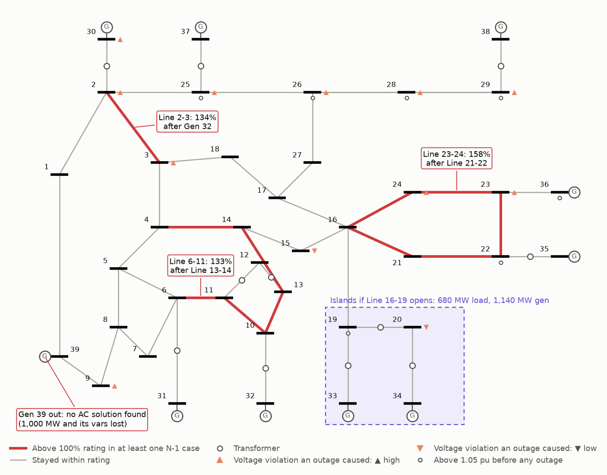

# Study memo: steady-state N-1 screening, IEEE 39-bus test system

**Date:** November 2026  
**From:** Jordan Leis (student practice study, built with Claude Code)  
**Status:** practice exercise on a public test case. Not a real system, not PSS/E.

**Purpose.** Screen the IEEE 39-bus test system for single-contingency (N-1) thermal and voltage problems, and estimate how much solar six buses could take before a new N-1 problem appears.

**Method.** AC Newton-Raphson load flow in pandapower. Each of 56 elements was removed in turn (35 lines, 11 transformers, 10 machines) and the case re-solved from the base solution. Criteria: 0.95-1.05 pu at every bus and 100% of the single rating in the case. Generator var limits applied. Lost generation shared across machines by headroom (Pmax - P). Buses cut off by an outage are treated as de-energised. A problem counts as caused by the outage only if it was not already there before it.

**Base case.** 6,254 MW load, 43.6 MW losses (0.70%). Peak loading Xfmr 10-32 at 77%. 7 buses (19, 22, 25, 26, 28, 29, 36) already sit above 1.05 pu (highest 1.0636 pu at bus 36). The swing machine at bus 31 runs at 678 MW against a 646 MW Pmax. These are conditions of the case, not contingency results.

**Results.** 22 of 56 outages are clean. 24 cause an overload and 13 a new or worsened voltage violation (2 of them only at the terminal bus of the tripped unit). 3 lose load, the largest when Line 16-19 opens and isolates 680 MW of load with 1,140 MW of generation. The worst overload is Line 23-24 at 158% with Line 21-22 out: the only other exit from the generation pocket at buses 22-23 (a hand cut-set estimate gives about 160%). Losing Gen 39, the case's interconnection equivalent, has no AC solution. Stepping it down in small warm-started steps solves while it still supplies 230 Mvar (bus 39 at 0.835 pu) and fails at 220 Mvar.

**What the assumptions change.** Line 2-3 is the worst element in 7 of 9 solved machine outages only because 790 of the 1101 MW of headroom sits on Gen 30. With the swing machine taking all lost MW instead, 14 outages overload rather than 24. Solar hosting runs from under 50 to 300 MW on the screening rule; at bus 8 it is 200 MW if all machines back off and 550 MW if only the swing does. At bus 15 the no-outage limit is 1,000 MW (the sweep cap) and the N-1 limit is 200 MW.

**Limits.** Steady-state AC only: no short circuit, no dynamics, no protection or remedial actions. Public textbook case with one rating per branch, not a real system. Not PSS/E. Hosting numbers are a screening estimate, not an interconnection study.

**Conclusions.** On this case the binding issues are thermal pockets around generation (buses 22-23, 2-3), radial supply to bus 20, and dependence on the bus-39 interconnection for voltage support. The answers depend on how lost or displaced generation is redispatched, so that assumption has to be stated next to any number.

**Worst five contingencies** (primary scenario)

| Rank | Outage | Result | Worst problem caused |
|---:|---|---|---|
| 1 | Gen 39 | No AC solution found (1,000 MW lost) | none |
| 2 | Line 16-19 | Islands bus 19, 20, 33, 34: 680 MW load lost | Line 2-3 at 109% |
| 3 | Xfmr 19-20 | Islands bus 20, 34: 680 MW load lost | none |
| 4 | Xfmr 6-31 | Islands bus 31: 9 MW load lost | Line 2-3 at 133% (+1 more) |
| 5 | Line 21-22 | Solved | Line 23-24 at 158% (+2 more) |

